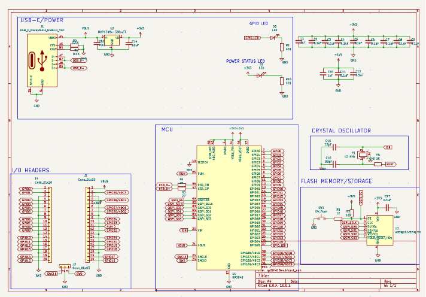
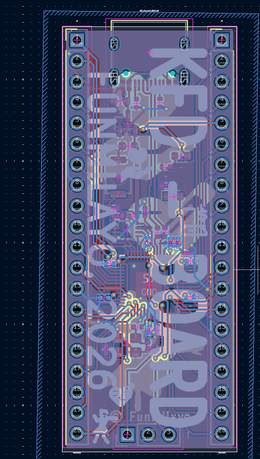
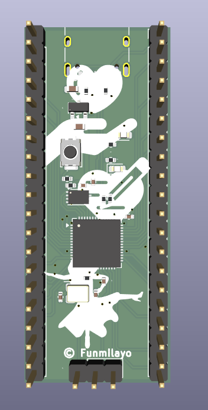
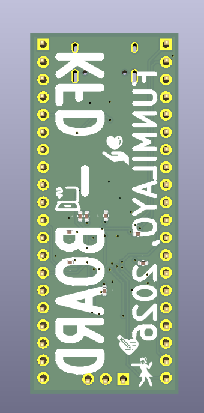
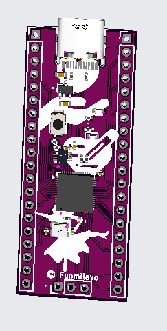
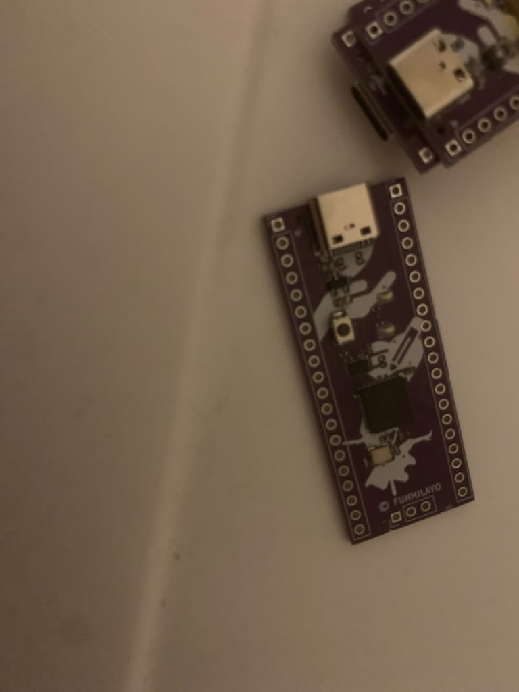

# D-BOARD 2026
This is my devboard! Built on the RP2040 chip, 30 keys (can you beat that?) and three layers to cover almost all keyboard inputs! There's the normal, number, and bluetooth layers! I love it so muchh!

It's purple when produced. look through all the images and journal.md!

## Images

### Schematic

### PCB Layout

### 3D Front View

### 3D Back View

### 3D Cool View

